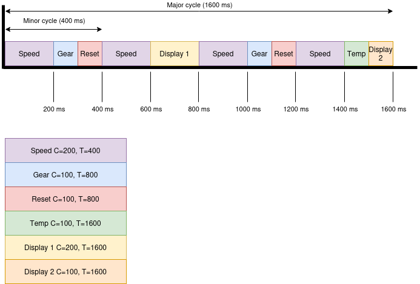

# TSM AdvEmbSof - Group 5 - Firmware Fanatics - 26/27

This repository contains the complete workspace for the course Advanced Embedded Software given by Serge Ayer at HES-SO Master.

## Students
- Atoub Faycal
- Mane Mame Thierno
- Mirkovitch Simon
- Rejas Christopher

## Project assessment

- Phase A: 18pts / 20pts
- Phase B:
- Phase C:
- Phase D:
- Total:  / 100 pts
- 
## Project Phases

- [Phase A: GitHub Infrastructure, Software Quality and Tests](#phase-a-github-infrastructure-software-quality-and-tests)
- [Phase B: Bike Computer Part 1](#phase-b--bikecomputer-part-i)
- [Phase B: Bike Computer Part 2](#phase-b--bikecomputer-part-ii)
- [Phase C: Multi-tasking under Zephyr OS](#phase-c--multi-tasking-under-zephyr-os)


## Phase A: GitHub Infrastructure, Software Quality and Tests
This phase contains the following delivrables:
- Deliverables/Requirements of the Getting Started codelab.
- Deliverables/Requirements of the Improving Software Quality codelab
- Deliverables/Requirements of the Digging into some Advanced Zephyr RTOS Concepts and Tools codelab.
- Deliverables/Requirements of the Embedded Software Testing codelab.

### Questions

#### Question 1: Document the behavior of each lookup implementation under different builds

The project implements three ways of accessing the lookup table. The first one, `lookup_c_assert`, uses the `ZPP_ASSERT` macro to check whether the index is out of bounds. The problem with this implementation is that the assertions will abort the program if the index is out of bounds.

The second function, `lookup_c_safe`, also checks the index boundaries, using if-else statements, which makes it safe by default. This implementation does not abort the program but will clamp the index value to 0 or size - 1.

However, the last one, lookup_cpp, calls the `std::array::at` method, which throws an exception when an out-of-bounds element is accessed. A solution would be to wrap the call in a try-catch block but this is generally discouraged on embedded systems. The other solution is to avoid this function altogether and enforce it with `clang-tidy` using the `bugprone-exception-escape check`. Another reason not to use this function is that Zephyr disables C++ exceptions by default.

We intentionally added a bug in the `sanitize` application that is not detected by `clang-tidy` but is
detected at runtime by a sanitizer other than the bounds sanitizer used for the lookup functions.
The function `scale_c_unsafe()` (lookup function 4) multiplies the sensor value by 2^28. When the
sensor value reaches 8, the result (2^31) does not fit in an `int32_t`: this is a signed integer overflow,
which is undefined behavior. The value is only known at runtime, so `clang-tidy` cannot detect it.

The bug is detected with `-fsanitize=signed-integer-overflow`, added to the sanitizer flags in
`sanitize/CMakeLists.txt`. All sanitizer flags are only enabled when `CONFIG_UBSAN` is set
(`san` config):

```cmake
if(CONFIG_UBSAN)
  zephyr_compile_options(-fsanitize=bounds -fsanitize=bounds-strict -fsanitize=signed-integer-overflow)
  zephyr_link_libraries(-fsanitize=bounds -fsanitize=bounds-strict -fsanitize=signed-integer-overflow)
endif()
```

With `shell+san`, the overflow is reported by the sanitizer:

```
uart:~$ inc 4
Using scale_c_unsafe
looking up sensor value: 7 -> 1879048192
uart:~$ inc 4
Using scale_c_unsafe
UBSAN: ERROR mul_overflow .../sanitize/src/main.cpp:62 8(s32) * 268435456(s32)
abort()
```

With `shell` (no sanitizer), the overflow is silent and the result is wrong:

```
uart:~$ inc 4
Using scale_c_unsafe
looking up sensor value: 8 -> -2147483648
```

This behavior differs from `lookup_c_assert()` with `shell+san`: since the debug options are not
enabled, the assertion is disabled and the out-of-bounds access is reported by the bounds sanitizer
(`UBSAN: ERROR out_of_bounds`), not by the signed integer overflow sanitizer.

## Phase B – BikeComputer Part I

Task set (values in ms, D = T, Φ = 0):

| Task        | C   | T    |
|-------------|-----|------|
| Speed       | 200 | 400  |
| Gear        | 100 | 800  |
| Reset       | 100 | 800  |
| Temperature | 100 | 1600 |
| Display 1   | 200 | 1600 |
| Display 2   | 100 | 1600 |

- Major cycle M = lcm(400, 800, 1600) = 1600 ms
- Minor cycle m = gcd(400, 800, 1600) = 400 ms
- M is a multiple of m, m <= Ti and m + (m - gcd(Ti, m)) <= Di for all tasks.
- Display (300 ms) cannot share a minor cycle with Speed (200 ms), so it is split into
  Display(1) = 200 ms and Display(2) = 100 ms.
- U = 200/400 + 100/800 + 100/800 + 100/1600 + 300/1600 = 1

 Minor cycle | Time (ms)   | Tasks                     | Load (ms) |
|-------------|-------------|---------------------------|-----------|
| 1           | 0 - 400     | Speed, Gear, Reset        | 400       |
| 2           | 400 - 800   | Speed, Display(1)         | 400       |
| 3           | 800 - 1200  | Speed, Gear, Reset        | 400       |
| 4           | 1200 - 1600 | Speed, Temp, Display(2)   | 400       |

Release times and deadlines (each job starts in [k*T, (k+1)*T - C]):

| Task        | Start times (ms)    | Allowed windows                           |
|-------------|---------------------|-------------------------------------------|
| Speed       | 100, 600, 900, 1300 | [0,200], [400,600], [800,1000], [1200,1400] |
| Gear        | 0, 800              | [0,700], [800,1500]                       |
| Reset       | 300, 1500           | [0,700], [800,1500]                       |
| Temperature | 1100                | [0,1500]                                  |
| Display(1)  | 400                 | [0,1400]                                  |
| Display(2)  | 1200                | [0,1500]                                  |

All constraints are met: the task set is schedulable with M = 1600 ms and m = 400 ms.

### Task scheduler diagram


### Bike system test duration

On the nrf5340dk board, `bike_system_part1` fails after about 22.3 s:

```
Task Reset started too late at call #27 (22303101 vs 22300000 us, allowedDelta 3051 us)
```

Since U = 1, there is no slack in the schedule: each major cycle lasts slightly more than 1600 ms
(loop and logging overhead), the delay accumulates and the Reset task, which starts exactly at the
upper bound of its window (1500 ms in the cycle), is the first one to exceed the allowed delta.
`CONFIG_TEST_DURATION_IN_MS` is therefore set to 20000 ms for nrf5340dk/nrf5340/cpuapp
(120000 ms is kept for qemu_x86).


#### Question 1: Response time of the reset event

*There is a large variation in the response time values, from a few milliseconds to hundreds of milliseconds.*

The large variation in response time comes from the cyclic scheduler system. The reset button is not handled when it is pressed, but only when the scheduler runs the reset task, which polls the button during its execution. The response time therefore depends on when the button is pressed relative to the reset task.

The reset task runs exactly twice per major cycle of 1600 ms:

Worst case: the button is pressed just after the reset task has finished, at about 400 ms. It is only detected at the next execution of the reset task, after Speed → Temperature → Display 1 → Speed → Gear → Reset, at about 1100 ms. The response time is then about 700 ms.

Best case: the button is pressed just before or while the reset task is running, for example during the gear task (Gear → Reset) or during the reset task itself. The press is then detected almost immediately, which gives a response time of only a few milliseconds.


*If you do not press long enough on the push button, the event may be missed and no reset happens.*

Because of the cyclic scheduler system, if we press the reset button and release it before the reset task gets executed, the reset task might miss the pressed button state. Which is why it is needed to press the button a certain amount of time before it gets handled.

Measured response times (press and hold BUTTON 1):

```
Reset task: response time is 495514 usecs
Reset task: response time is 904083 usecs
Reset task: response time is 760468 usecs
Reset task: response time is 510773 usecs
Reset task: response time is 919342 usecs
Reset task: response time is 480377 usecs
Reset task: response time is 888947 usecs
Reset task: response time is 376983 usecs
Reset task: response time is 785553 usecs
Reset task: response time is 242005 usecs
Reset task: response time is 650574 usecs
```

## Phase B – BikeComputer Part II

### Question 1 – CPU usage with the TTCE

With the CPU load measured as an additional TTCE task (once per major cycle):

```
CPU Load: 63.005%   (first measurement, includes start-up)
CPU Load: 99.007%
CPU Load: 99.007%
CPU Load: 99.006%
```

The CPU usage is about 99 %. The tasks simulate their computation time with a busy wait
(`kAllowSleep = false`: `TaskManager::simulate_computation_time()` loops on `get_uptime()` until the
computation time has elapsed). Since the sum of the computation times over a major cycle is
1600 ms = M (U = 1), every minor cycle of 400 ms is completely filled by tasks that keep the CPU busy,
and the idle thread almost never runs. The remaining ~1 % corresponds to the short gaps between the
end of the tasks of a minor cycle and the next TTCE timer tick. The first value (63 %) is lower because
the measurement interval includes the start-up phase, when the CPU is partly idle.

### Question 2 – CPU usage with sleep calls

With `kAllowSleep = true` in `static_scheduling_with_event::BikeSystem`:

```
CPU Load: 72.002%
CPU Load: 72.002%
CPU Load: 71.009%
```

The CPU usage drops from about 99 % to about 72 %. `TaskManager::simulate_computation_time()` now
puts the calling thread to sleep (`zpp_lib::ThisThread::sleep_for()`) for the remaining computation
time (minus `kAllowedDelta`) instead of busy-waiting, so the idle thread can run during that time.

The CPU usage does not drop further because the gear and speed tasks still poll the buttons
during their whole computation time: `GearDevice::get_current_gear()` and
`PedalDevice::get_current_rotation_time()` loop until the task computation time has elapsed, so
there is nothing left to sleep when `simulate_computation_time()` is called. This represents
2 x 100 ms (gear) + 4 x 200 ms (speed) = 1000 ms of busy waiting per major cycle of 1600 ms (62.5 %).
The remaining ~10 % is the actual work done by the other tasks (display update over SPI, sensor
reading), the short busy waits that complete each sleep and the CPU load logging task itself.

### Bike system test duration (TTCE)

| Version | Failure on nrf5340dk | `CONFIG_TEST_DURATION_IN_MS` |
|---|---|---|
| TTCE + `sleep_for` (buttons still polled) | 22.3 s (Task Reset, call #27) | 20000 |
| TTCE + event-driven devices (ISR + `std::atomic`) | 50.2 s (Task Speed, call #125) | 45000 |

On qemu_x86 the test is only built (Windows host), 120000 ms is kept.

With `sleep_for` only, the duration before failure is the same as with the Super-Loop. Sleeping
reduces the CPU load, but each task still lasts C. With U = 1 and the overhead of each task, a minor
cycle lasts slightly more than 400 ms: when the TTCE timer expires, the work item is still running
(`k_work_submit` returns 2) and it is executed again right after. The minor cycles are then chained
without waiting for the timer, and the delay accumulates as in the Super-Loop.

With the event-driven devices, `GearDevice` and `PedalDevice` no longer run a polling loop during
their computation time, so the overhead of each task is smaller and the delay accumulates more slowly.
The delay still exceeds `kAllowedDelta` because U = 1, but about twice later.

### Question 3 – CPU usage with the event-driven implementation

```
CPU Load: 17.002%
CPU Load: 17.005%
CPU Load: 20.007%
CPU Load: 17.003%
```

The CPU usage drops from about 72 % to about 17 % (20 % every third measurement). The buttons are
no longer polled: `GearDevice`, `PedalDevice` and `ResetDevice` register callbacks with
`InterruptIn::add_callback()` (the `RegistrationToken` is kept as a data member). The callbacks run in
ISR context and update `std::atomic` data members (lock-free on the Cortex-M33), with a
`store(memory_order_release)` in the ISR and a `load(memory_order_acquire)` in the task. The
1000 ms of busy waiting per major cycle are removed, and the whole computation time of each task is
now simulated with `sleep_for`, during which the idle thread runs.

The remaining 17 % is the actual work: display update over SPI, sensor reading and UART logging. The
20 % peaks come from the position of the measurement window relative to the display tasks.

### Question 4 – Response time of the reset event with interrupts

Measured response times (short presses on BUTTON 1):

```
Reset task: response time is 585937 usecs
Reset task: response time is 34698 usecs
Reset task: response time is 175109 usecs
Reset task: response time is 595124 usecs
Reset task: response time is 350098 usecs
Reset task: response time is 307740 usecs
Reset task: response time is 389710 usecs
Reset task: response time is 992951 usecs
Reset task: response time is 237641 usecs
Reset task: response time is 708466 usecs
Reset task: response time is 118560 usecs
Reset task: response time is 503418 usecs
```

**No event is missed and each press triggers exactly one reset.** The ISR `on_fall_button1()`
records the press time and sets an `std::atomic<bool>` flag (`store(true, memory_order_release)`).
`check_reset()` reads and clears the flag in one atomic operation
(`exchange(false, memory_order_acq_rel)`). The event is stored until `reset_task()` runs, so even a
very short press is detected, and holding the button no longer causes a second reset.

**The response time is still variable (35 ms to 993 ms).** The event is only handled when
`reset_task()` runs, at t = 300 ms and t = 1500 ms in the major cycle, so the response time still
depends on when the button is pressed within the cycle and is bounded by the gap between two
executions of the Reset task (up to 1200 ms), as with `static_scheduling::BikeSystem`.

This is an improvement over `static_scheduling::BikeSystem` for reliability (no lost events,
no double resets), but not for latency: the ISR only stores the event, and its processing is still
bound to the static schedule. Reducing the response

## Phase C – Multi-tasking under Zephyr OS


### Question 1: Using a `mutex` in an ISR and Deferring Work
with `CONFIG_WORK_ON_BUTTON_USE_WORK_QUEUE=n`

- We are not able to lock mutexes inside an ISR because of an assertion enabled in debug mode.

- We are able to lock a mutex using button 1 and release it after a certain amount of time within the same thread.

- We are able to lock a mutex when we are processing outside the CS.

- We are not able to lock a mutex and got an error message "Cannot lock mutexes"

- There is a new thread called ProcessingWorkQueue that is responsible of consuming workers in a separate thread. We can see that when we press the button, another thread (ProcessingWorkQueue thread) is trying to lock the mutex, unlike the step 2. 

---
### Question Multi-tasking under Zephyr OS/2

> *For each scenario, build your application using the command `just build multi_tasking/ log_app+debug+stats+gpio yes prj_multi_tasking.conf`. The different scenarios are created by modifying only the configuration parameters in the `prj_multi_tasking.conf` file. For this test, it is important not to enable logging for the `zpp_lib` library or for the kernel.*
> 
> Done. `CONFIG_LOG_MODE_IMMEDIATE` has been disabled.
> 
> *Scenario 1 / 2 / 3: The main thread is in a `Waiting` state, waiting for the `WaitOnButton` thread to terminate using the `Thread::join()` method. This is the default behavior with `CONFIG_WAIT_ON_BUTTON_SLEEP=y`. Change the priority of the `WaitOnButton` thread by modifying the `CONFIG_WAIT_ON_BUTTON_THREAD_PRIORITY` value to `8/9/10` (scenario 1 / 2 / 3) in the `prj_multi_tasking.conf` file.*


**Scenario 1**
`CONFIG_WAIT_ON_BUTTON_THREAD_PRIORITY=8`
`CONFIG_WAIT_ON_BUTTON_SLEEP=y`

```
Starting WaitOnButton demo
Waiting for button press
Thread started successfully
WaitOnButton demo started
Calling wait_started()wait_started() unblocked[00:00:00.333,404] <inf> zpp_rtos: === Threads Summary=
[00:00:00.339,355] <inf> zpp_rtos:  # |      Thread ID | Name         | State     | Prio | Stack (us)
[00:00:00.349,761] <inf> zpp_rtos: ---+----------------+--------------+-----------+------+-----------
[00:00:00.360,321] <inf> zpp_rtos:  0 |     0x20000200 | ButtonThread | pending   |    8 |  728 / 208
[00:00:00.370,178] <inf> zpp_rtos:  1 |     0x20000668 | sysworkq     | pending   |   -1 |  336 / 104
[00:00:00.380,004] <inf> zpp_rtos:  2 |     0x200003b0 | idle         | ready     |   15 |   48 / 32
[00:00:00.389,953] <inf> zpp_rtos:  3 |     0x20000478 | main         | queued    |    9 | 2608 / 406
[00:00:00.399,749] <inf> zpp_rtos: ---+----------------+------------+-----------+------+-------------

Button pressed with response time: 31 usecs
Waiting for button press
Button pressed with response time: 61 usecs
Waiting for button press
Button pressed with response time: 61 usecs
Waiting for button press
Button pressed with response time: 61 usecs
Waiting for button press
Button pressed with response time: 61 usecs
Waiting for button press
```

**Scenario 2**
`CONFIG_WAIT_ON_BUTTON_THREAD_PRIORITY=9`
`CONFIG_WAIT_ON_BUTTON_SLEEP=y`

```
Starting WaitOnButton demo
Thread started successfully
WaitOnButton demo started
Calling wait_started()Waiting for button press
wait_started() unblocked[00:00:00.333,282] <inf> zpp_rtos: === Threads Summary ===
[00:00:00.339,263] <inf> zpp_rtos:  # |      Thread ID | Name         | State     | Prio | Stack (us)
[00:00:00.349,639] <inf> zpp_rtos: ---+----------------+--------------+-----------+------+-----------
[00:00:00.360,229] <inf> zpp_rtos:  0 |     0x20000200 | ButtonThread | pending   |    9 |  728 / 208
[00:00:00.370,086] <inf> zpp_rtos:  1 |     0x20000668 | sysworkq     | pending   |   -1 |  336 / 104
[00:00:00.379,913] <inf> zpp_rtos:  2 |     0x200003b0 | idle         | ready     |   15 |   48 / 32
[00:00:00.389,862] <inf> zpp_rtos:  3 |     0x20000478 | main         | queued    |    9 | 2608 / 406
[00:00:00.399,688] <inf> zpp_rtos: ---+----------------+------------+-----------+------+-------------

Button pressed with response time: 61 usecs
Waiting for button press
Button pressed with response time: 30 usecs
Waiting for button press
Button pressed with response time: 31 usecs
Waiting for button press
Button pressed with response time: 61 usecs
Waiting for button press
Button pressed with response time: 31 usecs
Waiting for button press
```

**Scenario 3**
`CONFIG_WAIT_ON_BUTTON_THREAD_PRIORITY=10`
`CONFIG_WAIT_ON_BUTTON_SLEEP=y`

```
Starting WaitOnButton demo
Thread started successfully
WaitOnButton demo started
Calling wait_started()Waiting for button press
wait_started() unblocked[00:00:00.333,465] <inf> zpp_rtos: === Threads Summary ===
[00:00:00.339,416] <inf> zpp_rtos:  # |      Thread ID | Name         | State     | Prio | Stack (us)
[00:00:00.349,792] <inf> zpp_rtos: ---+----------------+--------------+-----------+------+-----------
[00:00:00.360,412] <inf> zpp_rtos:  0 |     0x20000200 | ButtonThread | queued    |   10 |  728 / 208
[00:00:00.370,269] <inf> zpp_rtos:  1 |     0x20000668 | sysworkq     | pending   |   -1 |  336 / 104
[00:00:00.380,096] <inf> zpp_rtos:  2 |     0x200003b0 | idle         | ready     |   15 |   48 / 32
[00:00:00.390,045] <inf> zpp_rtos:  3 |     0x20000478 | main         | queued    |    9 | 2608 / 406
[00:00:00.399,871] <inf> zpp_rtos: ---+----------------+------------+-----------+------+-------------

Button pressed with response time: 61 usecs
Waiting for button press
Button pressed with response time: 30 usecs
Waiting for button press
Button pressed with response time: 30 usecs
Waiting for button press
Button pressed with response time: 31 usecs
Waiting for button press
Button pressed with response time: 30 usecs
Waiting for button press
```

**Scenario 4**
`CONFIG_WAIT_ON_BUTTON_THREAD_PRIORITY=9`
`CONFIG_WAIT_ON_BUTTON_SLEEP=n`

```
Starting WaitOnButton demo
Thread started successfully
WaitOnButton demo started
Calling wait_started()Waiting for button press
wait_started() unblocked[00:00:00.333,374] <inf> zpp_rtos: === Threads Summary ===
[00:00:00.339,324] <inf> zpp_rtos:  # |      Thread ID | Name         | State     | Prio | Stack (us)
[00:00:00.349,731] <inf> zpp_rtos: ---+----------------+--------------+-----------+------+-----------
[00:00:00.360,321] <inf> zpp_rtos:  0 |     0x20000200 | ButtonThread | pending   |    9 |  728 / 208
[00:00:00.370,208] <inf> zpp_rtos:  1 |     0x20000668 | sysworkq     | pending   |   -1 |  336 / 104
[00:00:00.380,004] <inf> zpp_rtos:  2 |     0x200003b0 | idle         | ready     |   15 |   48 / 32
[00:00:00.389,984] <inf> zpp_rtos:  3 |     0x20000478 | main         | queued    |    9 | 2608 / 406
[00:00:00.399,780] <inf> zpp_rtos: ---+----------------+------------+-----------+------+-------------

Button pressed with response time: 2594 usecs
Waiting for button press
Button pressed with response time: 18371 usecs
Waiting for button press
Button pressed with response time: 8576 usecs
Waiting for button press
Button pressed with response time: 18829 usecs
Waiting for button press
Button pressed with response time: 9765 usecs
Waiting for button press
```


**Scenario 5**
`CONFIG_WAIT_ON_BUTTON_THREAD_PRIORITY=8`
`CONFIG_WAIT_ON_BUTTON_SLEEP=n`

```
Starting WaitOnButton demo
Waiting for button press
Thread started successfully
WaitOnButton demo started
Calling wait_started()wait_started() unblocked[00:00:00.333,618] <inf> zpp_rtos: === Threads Summary=
[00:00:00.339,569] <inf> zpp_rtos:  # |      Thread ID | Name         | State     | Prio | Stack (us)
[00:00:00.349,975] <inf> zpp_rtos: ---+----------------+--------------+-----------+------+-----------
[00:00:00.360,565] <inf> zpp_rtos:  0 |     0x20000200 | ButtonThread | pending   |    8 |  728 / 208
[00:00:00.370,422] <inf> zpp_rtos:  1 |     0x20000668 | sysworkq     | pending   |   -1 |  336 / 104
[00:00:00.380,249] <inf> zpp_rtos:  2 |     0x200003b0 | idle         | ready     |   15 |   48 / 32
[00:00:00.390,197] <inf> zpp_rtos:  3 |     0x20000478 | main         | queued    |    9 | 2608 / 406
[00:00:00.400,024] <inf> zpp_rtos: ---+----------------+------------+-----------+------+-------------

Button pressed with response time: 61 usecs
Waiting for button press
Button pressed with response time: 61 usecs
Waiting for button press
Button pressed with response time: 61 usecs
Waiting for button press
Button pressed with response time: 61 usecs
Waiting for button press
Button pressed with response time: 61 usecs
Waiting for button press
```
Faster reaction time after pressing the button because we set a higher priority on the configuration file.

**Scenario 6**
`CONFIG_WAIT_ON_BUTTON_THREAD_PRIORITY=10`
`CONFIG_WAIT_ON_BUTTON_SLEEP=n`

```
Starting WaitOnButton demo
Thread started successfully
WaitOnButton demo started
Calling wait_started()Waiting for button press
wait_started() unblocked[00:00:00.334,136] <inf> zpp_rtos: === Threads Summary ===
[00:00:00.340,087] <inf> zpp_rtos:  # |      Thread ID | Name         | State     | Prio | Stack (us)
[00:00:00.350,463] <inf> zpp_rtos: ---+----------------+--------------+-----------+------+-----------
[00:00:00.361,053] <inf> zpp_rtos:  0 |     0x20000200 | ButtonThread | queued    |   10 |  728 / 208
[00:00:00.370,910] <inf> zpp_rtos:  1 |     0x20000668 | sysworkq     | pending   |   -1 |  336 / 104
[00:00:00.380,737] <inf> zpp_rtos:  2 |     0x200003b0 | idle         | ready     |   15 |   48 / 32
[00:00:00.390,686] <inf> zpp_rtos:  3 |     0x20000478 | main         | queued    |    9 | 2608 / 406
[00:00:00.400,482] <inf> zpp_rtos: ---+----------------+------------+-----------+------+-------------
```
 Nothing  happens when we pressed on the button.

---
### Question Multi-tasking under Zephyr OS/3

> *The use of any `Mutex` object is not allowed in an ISR context. This is because locking a mutex can cause blocking, and any blocking code is not permitted in an ISR context.*
> 
> *You must modify the ticker callback so that the `Mutex` object is accessed from the ISR context. Demonstrate how to modify the callback and show the errors produced in the Zephyr RTOS kernel code.*

Modification done on `update_from_ticker()`
```C++
// update_from_ticker is used as a callback function for the ticker
// NOLINTNEXTLINE(readability-make-member-function-const)
void Clock::update_from_ticker() {
#if CONFIG_CURRENT_TIME_MUTEX
	auto m = _mutex.lock();
	ZPP_ASSERT(m, "Cannot lock mutex: %d", static_cast<int>(res.error()));
#endif // CONFIG_CURRENT_TIME_MUTEX

// this method runs in ISR mode -> we cannot allocate memory or perform other
// forbidden operation
	auto res = _update_queue.call(_update_work);
	ZPP_ASSERT(res, "Cannot call update on queue: %d", static_cast<int>(res.error()));

#if CONFIG_CURRENT_TIME_MUTEX
	m = _mutex.unlock();
	ZPP_ASSERT(m, "Cannot unlock mutex: %d", static_cast<int>(res.error()));
#endif // CONFIG_CURRENT_TIME_MUTEX
}
```

Error produced during runtime
```shell
ASSERTION FAIL [!arch_is_in_isr()] @ WEST_TOPDIR/deps/zephyr/kernel/mutex.c:115
        mutexes cannot be used inside ISRs
[00:00:01.265,930] <err> os: r0/a1:  0x00000004  r1/a2:  0x00000073  r2/a3:  0x00000000
[00:00:01.274,658] <err> os: r3/a4:  0x00000004 r12/ip:  0x00000000 r14/lr:  0x00009cb1
[00:00:01.283,386] <err> os:  xpsr:  0x01000025
[00:00:01.288,635] <err> os: Faulting instruction address (r15/pc): 0x000276ce
[00:00:01.296,569] <err> os: >>> ZEPHYR FATAL ERROR 4: Kernel panic on CPU 0
[00:00:01.304,351] <err> os: Fault during interrupt handling

[00:00:01.310,821] <err> os: Current thread: 0x200003b0 (idle)
[00:00:01.317,352] <err> os: Halting system
```

---
### Question Multi-tasking under Zephyr OS/4

> *The code to use all classes and simulate a producer/consumer scenario is given in the `main` program.*
> 
> *To gain an in-depth understanding of the program, make sure that the configuration parameter `CONFIG_BUFFER_USE_MUTEX_AND_SEMAPHORE` is set to `n` and proceed as follows:*
> 
> - *Scenario 1: Start the program with the producer running only (comment the call to `consumer.start()` in the `main` function). Make sure to run the program, describe what you observe and give an explanation of your observations. In particular, answer the following questions:*
>     1. *Which led is blinking?*
>     2. *How is the `_producer_index` value of the `Buffer` class changing?*
>     3. *Can the producer overwrite values that have not be consumed?*
> 
> - *Scenario 2: Do the opposite and start the program with the consumer running only. Answer the same corresponding questions.*
>     
> - *Scenario 3 / 4: Then, start the program with both the producer and consumer running. Answer the same questions again. Experiment with different time values, simulating both cases where production is faster than consumption (Scenario 3) and where consumption is faster than production (Scenario 4). This can be accomplished by making `kApppendWaitTime` or `kExtractWaitTime` much smaller than the other waiting time.*
> 
> *Answer all questions for each different scenario above.*

####  Scenario 1

1. `LED1` is blinking
2. Rotating like a circular buffer. After it goes to 9, it goes back to 0, erasing the previous value that was on that index. This is because the size of the buffer is limited by the constant value `kBufferSize`.
3. Yes because of the mecanism explained on b.

```
Performing processing in CS, thread (0x200002c8)
Multi-tasking program started
Starting Consumer/Producer demo
Producer data is (2, 2) (index in buffer 0)
Producer data is (1, 1) (index in buffer 1)
Producer data is (1, 1) (index in buffer 2)
Producer data is (1, 1) (index in buffer 3)
Producer data is (1, 1) (index in buffer 4)
Producer data is (1, 1) (index in buffer 5)
Producer data is (2, 2) (index in buffer 6)
Producer data is (2, 2) (index in buffer 7)
Producer data is (5, 5) (index in buffer 8)
Producer data is (3, 3) (index in buffer 9)
Producer data is (5, 5) (index in buffer 0) <-- Back to index 0
Producer data is (1, 1) (index in buffer 1)
Producer data is (4, 4) (index in buffer 2)
Producer data is (4, 4) (index in buffer 3)
```

#### Scenario 2

1. `LED2` is blinking
2. Same as the producer, `_consumer_index` gets incremented until it reaches `kBufferSize` before going back to 0.
3. Consumer does not override the values since it reads it only from the buffer.

```
Multi-tasking program started
Starting Consumer/Producer demo
Consumer data is (0, 0) (index in buffer 0)
Consumer data is (0, 0) (index in buffer 1)
Consumer data is (0, 0) (index in buffer 2)
Consumer data is (0, 0) (index in buffer 3)
Consumer data is (0, 0) (index in buffer 4)
Consumer data is (0, 0) (index in buffer 5)
Consumer data is (0, 0) (index in buffer 6)
Consumer data is (0, 0) (index in buffer 7)
Consumer data is (0, 0) (index in buffer 8)
Consumer data is (0, 0) (index in buffer 9)
Consumer data is (0, 0) (index in buffer 0) <-- Back to index 0
Consumer data is (0, 0) (index in buffer 1)
Consumer data is (0, 0) (index in buffer 2)
Consumer data is (0, 0) (index in buffer 3)
```

#### Scenario 3

**Producer and consumer wait times**
```c++
static constexpr std::chrono::milliseconds kApppendWaitTime = 100ms;
static constexpr std::chrono::milliseconds kExtractWaitTime = 200ms;
```

**Output**
```
Multi-tasking program started
Starting Consumer/Producer demo
Producer data is (1, 1) (index in buffer 0) <-- [1]
Producer data is (4, 4) (index in buffer 1) <-- [1, 4]
Consumer data is (1, 1) (index in buffer 0) <-- pop 1
Producer data is (5, 5) (index in buffer 2) <-- [4, 5]
Producer data is (1, 1) (index in buffer 3) <-- [4, 5, 1]
Consumer data is (4, 4) (index in buffer 1) <-- pop 4
Producer data is (1, 1) (index in buffer 4) <-- [5, 1, 1]
Producer data is (4, 4) (index in buffer 5) <-- [5, 1, 1, 4]
Consumer data is (5, 5) (index in buffer 2) <-- pop 5
Producer data is (2, 2) (index in buffer 6) <-- [1, 1, 4]
Consumer data is (1, 1) (index in buffer 3) <-- pop 1
Producer data is (4, 4) (index in buffer 7) <-- [1, 4]
Producer data is (1, 1) (index in buffer 8) <-- [1, 4, 1]
Producer data is (3, 3) (index in buffer 9) <-- [1, 4, 1, 3]
Consumer data is (1, 1) (index in buffer 4) <-- pop 1
Producer data is (2, 2) (index in buffer 0) <-- [4, 1, 3]
Consumer data is (4, 4) (index in buffer 5) <-- pop 4
```

**Observations**
This scenario looks correct from the output point of view. Consumer always pop the value to the according index added by the producer to the buffer. 

But in reality, this works only because the consumer waiting time is longer that the producer one. Plus of that, at some point, the producer will start erasing values that has not been read yet by the consumer.

#### Scenario 4

**Producer and consumer wait times**
```c++
static constexpr std::chrono::milliseconds kApppendWaitTime = 400ms;
static constexpr std::chrono::milliseconds kExtractWaitTime = 100ms;
```

**Output**
```
Multi-tasking program started
Starting Consumer/Producer demo
Consumer data is (1, 1) (index in buffer 0)
Consumer data is (0, 0) (index in buffer 1)
Consumer data is (0, 0) (index in buffer 2)
Consumer data is (0, 0) (index in buffer 3)
Producer data is (1, 1) (index in buffer 0)
Consumer data is (0, 0) (index in buffer 4)
Consumer data is (0, 0) (index in buffer 5)
Consumer data is (0, 0) (index in buffer 6)
Consumer data is (0, 0) (index in buffer 7)
Producer data is (2, 2) (index in buffer 1)
Consumer data is (0, 0) (index in buffer 8)
Consumer data is (0, 0) (index in buffer 9)
Consumer data is (1, 1) (index in buffer 0)
Consumer data is (2, 2) (index in buffer 1)
Producer data is (4, 4) (index in buffer 2)
Consumer data is (4, 4) (index in buffer 2)
```

**Observations**
It looks like it does not work as a producer/consumer because the consumer never waits for the data from the producer. It fetch the data right after it's waiting time is reached. From that conclusion, a synchronization mechanism is needed.


Multi-tasking program started
Starting Consumer/Producer demo
Producer data is (1, 1) (index in buffer 0) 1
Consumer data is (1, 1) (index in buffer 0) 1

Producer data is (5, 5) (index in buffer 1) 1 5
Producer data is (1, 1) (index in buffer 2) 1 5 1
Consumer data is (5, 5) (index in buffer 1) 5

Producer data is (4, 4) (index in buffer 3) 1 5 1 4
Consumer data is (1, 1) (index in buffer 2) 1

Producer data is (3, 3) (index in buffer 4) 1 5 1 4 3
Consumer data is (4, 4) (index in buffer 3) 4

Producer data is (5, 5) (index in buffer 5) 1 5 1 4 3 5
Consumer data is (3, 3) (index in buffer 4) 3

Producer data is (3, 3) (index in buffer 6) 1 5 1 4 3 5 6
Consumer data is (5, 5) (index in buffer 5) 5


---
### Question Multi-tasking under Zephyr OS/5

> *Assuming that the `Mutex` and `Semaphore` mechanisms are fully and correctly implemented, describe what happens if you remove the calls below in the `Buffer` class:*
> 
> *- `_in_semaphore.acquire()`*
> *- `_in_semaphore.release()`*
> *- `_out_semaphore.acquire()`*
> *- `_out_semaphore.release()`*


`_in_semaphore.acquire()`
The producer stops checking for a free slot. When it gets 9 items ahead of the consumer, it will override the data that hasn't been read yet by the consumer.

`_in_semaphore.release()`
Slots are never released back to the producer. After 9 items it blocks forever, the consumer empties the buffer and blocks too. This will lead to a deadlock.

`_out_semaphore.acquire()`
The consumer will not wait for data added by the producer. So it will consume data that might have been already read.

`_out_semaphore.release()`
The consumer is never tells the producer that there is an available slot. The producer will fill 9 slots and then block. This will lead to a deadlock.

### Question Multi-tasking under Zephyr OS/6

We used the file `buffer_mqueue.hpp` with some modification to be API compatible with the original `Buffer` class.

- We added the template to the class
- We modified the timeout value to 1h instead of `max()`. After some investigation it seems that it could lead to some issue to use the maximum timeout value due to some calculations overflow.

---
