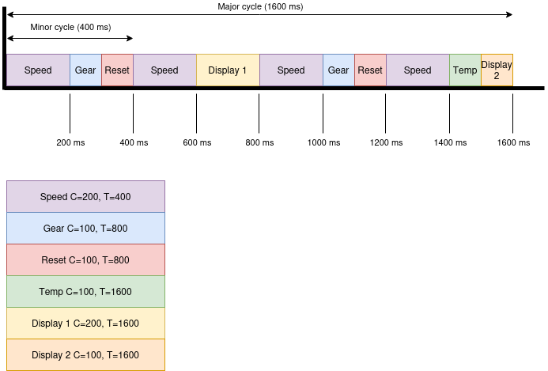

# TSM AdvEmbSof - Group 5 - Firmware Fanatics - 26/27

This repository contains the complete workspace for the course Advanced Embedded Software given by Serge Ayer at HES-SO Master.

## Students
- Atoub Faycal
- Mane Mame Thierno
- Mirkovitch Simon
- Rejas Christopher

## Project Phases

- [Phase A: GitHub Infrastructure, Software Quality and Tests](#phase-a-github-infrastructure-software-quality-and-tests)
- [Phase B: Bike Computer Part 1 and 2](#phase-b-bike-computer-part-1-and-2)

## Phase A: GitHub Infrastructure, Software Quality and Tests
This phase contains the following delivrables:
- Deliverables/Requirements of the Getting Started codelab.
- Deliverables/Requirements of the Improving Software Quality codelab
- Deliverables/Requirements of the Digging into some Advanced Zephyr RTOS Concepts and Tools codelab.
- Deliverables/Requirements of the Embedded Software Testing codelab.

### Questions

#### Question 1: Document the behavior of each lookup implementation under different builds

The project implements three ways of accessing the lookup table. The first one, `lookup_c_assert`, uses the `ZPP_ASSERT` macro to check whether the index is out of bounds. The problem with this implementation is that the assertions will abort the program if the index is out of bounds.

The second function, `lookup_c_safe`, also checks the index boundaries, using if-else statements, which makes it safe by default. This implementation does not abort the program but will clamp the index value to 0 or size - 1.

However, the last one, lookup_cpp, calls the `std::array::at` method, which throws an exception when an out-of-bounds element is accessed. A solution would be to wrap the call in a try-catch block but this is generally discouraged on embedded systems. The other solution is to avoid this function altogether and enforce it with `clang-tidy` using the `bugprone-exception-escape check`. Another reason not to use this function is that Zephyr disables C++ exceptions by default.

We intentionnally added a bug on `sanitize` project that tries to access a C-array without boudaries checking. We called the function `lookup_c_super_unsafe`. This is not detected by clang-tidy but it is detected by the sanitizer during the runtime. The following logs show when the sanitizer detects the out_of_bounds error:

```
uart:~$ inc 4

Using lookup_c_super_unsafe

looking up sensor value: 1 -> 10

uart:~$ inc 4

Using lookup_c_super_unsafe

looking up sensor value: 2 -> 20

uart:~$ inc 4

Using lookup_c_super_unsafe

looking up sensor value: 3 -> 30

uart:~$ inc 4

Using lookup_c_super_unsafe

looking up sensor value: 4 -> 40

uart:~$ inc 4

Using lookup_c_super_unsafe

looking up sensor value: 5 -> 50

uart:~$ inc 4

Using lookup_c_super_unsafe

looking up sensor value: 6 -> 60

uart:~$ inc 4

Using lookup_c_super_unsafe

looking up sensor value: 7 -> 70

uart:~$ inc 4

Using lookup_c_super_unsafe

looking up sensor value: 8 -> 80

uart:~$ inc 4

Using lookup_c_super_unsafe

UBSAN: ERROR out_of_bounds /home/cre/MSE/TSM_AdvEmbSof/Codelabs/workspace/sanitize/src/main.cpp:73 (]

abort()

r0/a1:  0x00000004  r1/a2:  0x00011eb1  r2/a3:  0x00000000

r3/a4:  0x00000004 r12/ip:  0x00000001 r14/lr:  0x000058bd

xpsr:  0x21000000

Faulting instruction address (r15/pc): 0x000058cc
```

## Phase B – BikeComputer Part I

Task set (values in ms, D = T, Φ = 0):

| Task        | C   | T    |
|-------------|-----|------|
| Speed       | 200 | 400  |
| Gear        | 100 | 800  |
| Reset       | 100 | 800  |
| Temperature | 100 | 1600 |
| Display 1   | 200 | 1600 |
| Display 2   | 100 | 1600 |

- Major cycle M = lcm(400, 800, 1600) = 1600 ms
- Minor cycle m = gcd(400, 800, 1600) = 400 ms
- M is a multiple of m, m <= Ti and m + (m - gcd(Ti, m)) <= Di for all tasks.
- Display (300 ms) cannot share a minor cycle with Speed (200 ms), so it is split into
  Display(1) = 200 ms and Display(2) = 100 ms.
- U = 200/400 + 100/800 + 100/800 + 100/1600 + 300/1600 = 1

 Minor cycle | Time (ms)   | Tasks                     | Load (ms) |
|-------------|-------------|---------------------------|-----------|
| 1           | 0 - 400     | Speed, Gear, Reset        | 400       |
| 2           | 400 - 800   | Speed, Display(1)         | 400       |
| 3           | 800 - 1200  | Speed, Gear, Reset        | 400       |
| 4           | 1200 - 1600 | Speed, Temp, Display(2)   | 400       |

Release times and deadlines (each job starts in [k*T, (k+1)*T - C]):

| Task        | Start times (ms)    | Allowed windows                           |
|-------------|---------------------|-------------------------------------------|
| Speed       | 100, 600, 900, 1300 | [0,200], [400,600], [800,1000], [1200,1400] |
| Gear        | 0, 800              | [0,700], [800,1500]                       |
| Reset       | 300, 1500           | [0,700], [800,1500]                       |
| Temperature | 1100                | [0,1500]                                  |
| Display(1)  | 400                 | [0,1400]                                  |
| Display(2)  | 1200                | [0,1500]                                  |

All constraints are met: the task set is schedulable with M = 1600 ms and m = 400 ms.

### Task scheduler diagram


### Bike system test duration

On the nrf5340dk board, `bike_system_part1` fails after about 22.3 s:

```
Task Reset started too late at call #27 (22303101 vs 22300000 us, allowedDelta 3051 us)
```

Since U = 1, there is no slack in the schedule: each major cycle lasts slightly more than 1600 ms
(loop and logging overhead), the delay accumulates and the Reset task, which starts exactly at the
upper bound of its window (1500 ms in the cycle), is the first one to exceed the allowed delta.
`CONFIG_TEST_DURATION_IN_MS` is therefore set to 20000 ms for nrf5340dk/nrf5340/cpuapp
(120000 ms is kept for qemu_x86).


#### Question 1: Response time of the reset event

*There is a large variation in the response time values, from a few milliseconds to hundreds of milliseconds.*

The large variation in response time comes from the cyclic scheduler system. The reset button is not handled when it is pressed, but only when the scheduler runs the reset task, which polls the button during its execution. The response time therefore depends on when the button is pressed relative to the reset task.

The reset task runs exactly twice per major cycle of 1600 ms:

Worst case: the button is pressed just after the reset task has finished, at about 400 ms. It is only detected at the next execution of the reset task, after Speed → Temperature → Display 1 → Speed → Gear → Reset, at about 1100 ms. The response time is then about 700 ms.

Best case: the button is pressed just before or while the reset task is running, for example during the gear task (Gear → Reset) or during the reset task itself. The press is then detected almost immediately, which gives a response time of only a few milliseconds.


*If you do not press long enough on the push button, the event may be missed and no reset happens.*

Because of the cyclic scheduler system, if we press the reset button and release it before the reset task gets executed, the reset task might miss the pressed button state. Which is why it is needed to press the button a certain amount of time before it gets handled.

Measured response times (press and hold BUTTON 1):

```
Reset task: response time is 495514 usecs
Reset task: response time is 904083 usecs
Reset task: response time is 760468 usecs
Reset task: response time is 510773 usecs
Reset task: response time is 919342 usecs
Reset task: response time is 480377 usecs
Reset task: response time is 888947 usecs
Reset task: response time is 376983 usecs
Reset task: response time is 785553 usecs
Reset task: response time is 242005 usecs
Reset task: response time is 650574 usecs
```

## Phase B – BikeComputer Part II

### Question 1 – CPU usage with the TTCE

With the CPU load measured as an additional TTCE task (once per major cycle):

```
CPU Load: 63.005%   (first measurement, includes start-up)
CPU Load: 99.007%
CPU Load: 99.007%
CPU Load: 99.006%
```

The CPU usage is about 99 %. The tasks simulate their computation time with a busy wait
(`kAllowSleep = false`: `TaskManager::simulate_computation_time()` loops on `get_uptime()` until the
computation time has elapsed). Since the sum of the computation times over a major cycle is
1600 ms = M (U = 1), every minor cycle of 400 ms is completely filled by tasks that keep the CPU busy,
and the idle thread almost never runs. The remaining ~1 % corresponds to the short gaps between the
end of the tasks of a minor cycle and the next TTCE timer tick. The first value (63 %) is lower because
the measurement interval includes the start-up phase, when the CPU is partly idle.

### Question 2 – CPU usage with sleep calls

With `kAllowSleep = true` in `static_scheduling_with_event::BikeSystem`:

```
CPU Load: 72.002%
CPU Load: 72.002%
CPU Load: 71.009%
```

The CPU usage drops from about 99 % to about 72 %. `TaskManager::simulate_computation_time()` now
puts the calling thread to sleep (`zpp_lib::ThisThread::sleep_for()`) for the remaining computation
time (minus `kAllowedDelta`) instead of busy-waiting, so the idle thread can run during that time.

The CPU usage does not drop further because the gear and speed tasks still poll the buttons
during their whole computation time: `GearDevice::get_current_gear()` and
`PedalDevice::get_current_rotation_time()` loop until the task computation time has elapsed, so
there is nothing left to sleep when `simulate_computation_time()` is called. This represents
2 x 100 ms (gear) + 4 x 200 ms (speed) = 1000 ms of busy waiting per major cycle of 1600 ms (62.5 %).
The remaining ~10 % is the actual work done by the other tasks (display update over SPI, sensor
reading), the short busy waits that complete each sleep and the CPU load logging task itself.

### Bike system test duration (TTCE)

| Version | Failure on nrf5340dk | `CONFIG_TEST_DURATION_IN_MS` |
|---|---|---|
| TTCE + `sleep_for` (buttons still polled) | 22.3 s (Task Reset, call #27) | 20000 |
| TTCE + event-driven devices (ISR + `std::atomic`) | 50.2 s (Task Speed, call #125) | 45000 |

On qemu_x86 the test is only built (Windows host), 120000 ms is kept.

With `sleep_for` only, the duration before failure is the same as with the Super-Loop. Sleeping
reduces the CPU load, but each task still lasts C. With U = 1 and the overhead of each task, a minor
cycle lasts slightly more than 400 ms: when the TTCE timer expires, the work item is still running
(`k_work_submit` returns 2) and it is executed again right after. The minor cycles are then chained
without waiting for the timer, and the delay accumulates as in the Super-Loop.

With the event-driven devices, `GearDevice` and `PedalDevice` no longer run a polling loop during
their computation time, so the overhead of each task is smaller and the delay accumulates more slowly.
The delay still exceeds `kAllowedDelta` because U = 1, but about twice later.

### Question 3 – CPU usage with the event-driven implementation

```
CPU Load: 17.002%
CPU Load: 17.005%
CPU Load: 20.007%
CPU Load: 17.003%
```

The CPU usage drops from about 72 % to about 17 % (20 % every third measurement). The buttons are
no longer polled: `GearDevice`, `PedalDevice` and `ResetDevice` register callbacks with
`InterruptIn::add_callback()` (the `RegistrationToken` is kept as a data member). The callbacks run in
ISR context and update `std::atomic` data members (lock-free on the Cortex-M33), with a
`store(memory_order_release)` in the ISR and a `load(memory_order_acquire)` in the task. The
1000 ms of busy waiting per major cycle are removed, and the whole computation time of each task is
now simulated with `sleep_for`, during which the idle thread runs.

The remaining 17 % is the actual work: display update over SPI, sensor reading and UART logging. The
20 % peaks come from the position of the measurement window relative to the display tasks.

### Question 4 – Response time of the reset event with interrupts

Measured response times (short presses on BUTTON 1):

```
Reset task: response time is 585937 usecs
Reset task: response time is 34698 usecs
Reset task: response time is 175109 usecs
Reset task: response time is 595124 usecs
Reset task: response time is 350098 usecs
Reset task: response time is 307740 usecs
Reset task: response time is 389710 usecs
Reset task: response time is 992951 usecs
Reset task: response time is 237641 usecs
Reset task: response time is 708466 usecs
Reset task: response time is 118560 usecs
Reset task: response time is 503418 usecs
```

**No event is missed and each press triggers exactly one reset.** The ISR `on_fall_button1()`
records the press time and sets an `std::atomic<bool>` flag (`store(true, memory_order_release)`).
`check_reset()` reads and clears the flag in one atomic operation
(`exchange(false, memory_order_acq_rel)`). The event is stored until `reset_task()` runs, so even a
very short press is detected, and holding the button no longer causes a second reset.

**The response time is still variable (35 ms to 993 ms).** The event is only handled when
`reset_task()` runs, at t = 300 ms and t = 1500 ms in the major cycle, so the response time still
depends on when the button is pressed within the cycle and is bounded by the gap between two
executions of the Reset task (up to 1200 ms), as with `static_scheduling::BikeSystem`.

This is an improvement over `static_scheduling::BikeSystem` for reliability (no lost events,
no double resets), but not for latency: the ISR only stores the event, and its processing is still
bound to the static schedule. Reducing the response